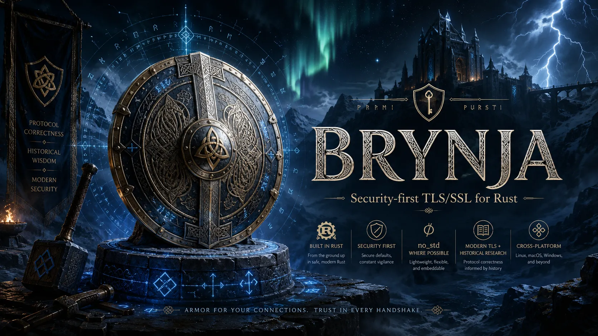

<p align="center">
  <b>Security-first, first-party Rust, no_std cryptography and secure protocols.</b><br>
  Built in small reviewable releases with strict modern, legacy, and research isolation.
</p>

<div align="center">
  <a href="https://crates.io/crates/brynja-cipher-aes">Crates.io</a>
  |
  <a href="https://docs.rs/brynja-cipher-aes">Docs.rs</a>
  |
  <a href="https://github.com/valkyoth/brynja/blob/main/docs/RELEASE_PLAN.md">Release Plan</a>
  |
  <a href="https://github.com/valkyoth/brynja/blob/main/docs/threat-model.md">Threat Model</a>
  |
  <a href="https://github.com/valkyoth/brynja/blob/main/SECURITY.md">Security</a>
</div>

<br>

<p align="center">
  <a href="https://github.com/valkyoth/brynja">
    
  </a>
</p>

# brynja-cipher-aes

Enable `hazmat-aes-block` for the portable AES-128, AES-192 and AES-256
single-block owners under `brynja_cipher_aes::aes`. They borrow caller
storage; ephemeral keys expand per operation and expanded keys cache their
schedule until clear or drop. Raw blocks do not authenticate messages.

## Cryptography Verification Status

| Capability | Implemented | Independently verified |
| --- | --- | --- |
| Portable, allocation-free `no_std` AES-128/192/256 (one 16-byte block per call) | ✅ Implemented | ❌ Not independently verified |
| Accelerated or external-key execution (explicit opt-in) | ✅ Implemented | ❌ Not independently verified |

## Use one block

Enable `hazmat-aes-block` on the standalone dependency. This example uses
the public all-zero AES-128 known answer, not an application key:

```rust
use brynja_cipher_aes::aes::{Aes128Key, Error};

fn main() -> Result<(), Error> {
    let mut storage = [0; 16];
    let key = Aes128Key::new(&[0; 16], &mut storage)?;
    let mut output = [0; 16];
    let block = key.encrypt_block(&[0; 16], &mut output)?;
    assert_eq!(block.expose(), &0x66e94bd4ef8a2c3b884cfa59ca342b2eu128.to_be_bytes());
    block.clear();
    assert_eq!(output, [0; 16]);
    Ok(())
}
```

For message encryption use an authenticated construction such as
[`brynja-aead-gcm`](https://github.com/valkyoth/brynja/tree/main/crates/brynja-aead-gcm).

## Hardware and providers

There are no default features. Hardware execution (`aes-static-execution`
or `aes-runtime-execution`) is an explicit opt-in;
the existing CPU authority must admit the requested backend. The separate
`external-key-provider` feature supplies lifecycle contracts, not an HSM
driver. No block mode, timing qualification, or physical erasure guarantee
is provided. The `brynja_crypto::aes` compatibility API uses the same owners.

MIT OR Apache-2.0.
