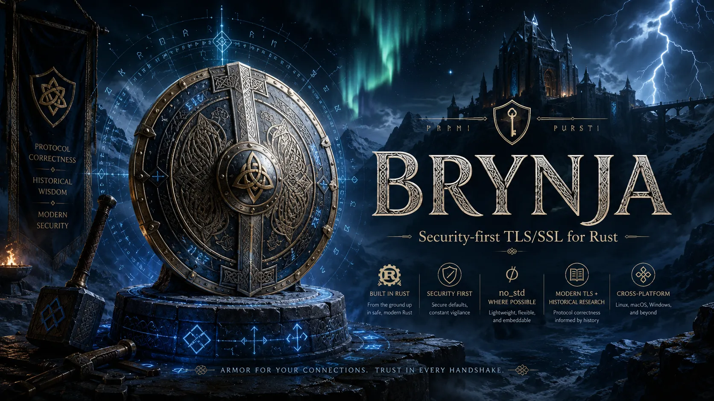

<p align="center">
  <b>Security-first, first-party Rust, no_std cryptography and secure protocols.</b><br>
  Built in small reviewable releases with strict modern, legacy, and research isolation.
</p>

<div align="center">
  <a href="https://crates.io/crates/brynja-crypto">Crates.io</a>
  |
  <a href="https://docs.rs/brynja-crypto">Docs.rs</a>
  |
  <a href="https://github.com/valkyoth/brynja/blob/main/docs/RELEASE_PLAN.md">Release Plan</a>
  |
  <a href="https://github.com/valkyoth/brynja/blob/main/docs/threat-model.md">Threat Model</a>
  |
  <a href="https://github.com/valkyoth/brynja/blob/main/SECURITY.md">Security</a>
</div>

<br>

<p align="center">
  <a href="https://github.com/valkyoth/brynja">
    
  </a>
</p>

# brynja-crypto

Brynja's `no_std`, protocol-facing cryptographic composition and policy
boundary. Reusable leaf crates implement algorithms; this crate reexports
their APIs without making each leaf depend on the entire crypto or TLS graph.

## Cryptography Verification Status

Project test results and their exact scope are recorded in the
[completed project checkpoint](https://github.com/valkyoth/brynja/blob/main/release-notes/RELEASE_NOTES_0.25.2.md#completed-checkpoint-handoff-2026-10-31)
and its linked native/retest records. These are project assurance results,
not independent cryptographic certification or coverage of every deployment.

| Capability | Implemented | Independently verified |
| --- | --- | --- |
| All six named SHA-2 and all six SHA-3/SHAKE functions | ✅ Fully implemented, reexported | ❌ No |
| cSHAKE, KMAC/KMACXOF, TupleHash and ParallelHash families | ✅ Fully implemented, reexported | ❌ No |
| Modern HMAC over SHA-2/SHA-3 | ✅ Fully implemented portable API; explicit execution qualification separate | ❌ No |
| HKDF and TLS Expand-Label over six standard SHA-2 identities | Development implementation; qualification unfinished | ❌ No |
| AEAD, other KDFs, RSA, ECC and executable provider effects | ❌ Not implemented | ❌ No |

Named hashes and SP 800-185 constructions are usable; the broader planned
cryptographic composition layer is not complete. No independent cryptographic
review or FIPS 140-3 validation is claimed.

The `hkdf` module is new, unpublished 0.26.0 development work. It uses explicit
SHA-2 identities, caller-backed `Prk`/`DerivedKey` clearing owners and no
allocation or implicit backend selection. Import requires an already
pseudorandom key; it does not replace Extract for raw input key material.
Public length/label rejections leave output unchanged; errors after secret
output initialization clear the destination. Dropping a successful owner clears
its buffer. Application copies, forgotten owners, compiler spills, aborts and
host-memory protection remain outside those cleanup guarantees.
See `hkdf::Prk` API examples and `brynja-verify hkdf` for scoped observations;
these results are neither a full HKDF assessment nor a release gate.
Historical HKDF-SHA-1 is available only through the separate development crate
`brynja-legacy-hkdf` with explicit legacy acknowledgement. It is not a feature
or dependency of this modern crate and is tracked under `legacy_hkdf`.

## Use

The independent, default-off `external-key-provider` feature exposes
algorithm-neutral `provider::{ExternalKey, OwnedKeyBackend}` lifecycle contracts.
It does not enable AES. Enable it together with `hazmat-aes-block` to use
`aes::provider::{Aes128Backend, Aes128ProviderKey, Permissions}` (and distinct
`Aes192Backend`/`Aes192ProviderKey`, `Aes256Backend`/`Aes256ProviderKey`) with a trusted
application/device adapter. Both features forward explicitly through `brynja`.
No hardware driver, PKCS#11 integration, automatic fallback or HSM requirement
is bundled. Software keys remain unchanged; provider keys use opaque bindings,
not imported key bytes. Drop releases the adapter, not the device key; explicit
destruction requires an owning adapter. Adapter/device qualification is separate.

The internal v0.27.2 acceptance candidate retains raw software AES-128/192/256 blocks under
the **default-off** `hazmat-aes-block` feature. Enable that feature explicitly
on either `brynja-crypto` or `brynja` when using the matching checkout. No HSM
is required. This is not message encryption or an AEAD: no authentication,
padding, nonce management or TLS integration is included. Physical fault
detection, compiler-spill erasure and cross-target side-channel qualification
are not promised. See the repository's `docs/assurance/aes128-pentest-remediation.md`.
For repeated blocks, `aes::Aes128ExpandedKey` optionally retains its schedule in
176 caller-owned clearing bytes; `aes::Aes128Key` retains the smaller 16-byte key
and expands per operation. Both remain raw, unauthenticated block APIs. The
bounded target/compiler support matrix is in `docs/assurance/aes128-development.md`.

AES-192 and AES-256 have distinct `aes::Aes192Key`/`aes::Aes256Key` types,
requiring 24/32 caller-owned key bytes. Their optional `Aes192ExpandedKey`/
`Aes256ExpandedKey` forms require 208/240 caller-owned clearing schedule bytes.
Every operation still handles exactly one 16-byte block. Both key forms provide
secret `encrypt_block`/`decrypt_block` output and explicitly acknowledged
`encrypt_block_public`; there is no public decrypt or automatic key-size choice.
Input key copies remain the caller's responsibility. Cached schedules increase
the lifetime and footprint of key-equivalent material. See
`docs/assurance/aes-wide-development.md` for their separate evidence and limits.
The optional external-key provider interface covers AES-128, AES-192 and
AES-256 through separate typed bindings. The adapter must validate the actual
device key width; the trait name alone is not hardware attestation. No PKCS#11
client or hardware support is bundled in this crate.

The ordinary AES-192/256 key forms rebuild their full schedule on every block.
For repeated blocks in a separately reviewed construction, prefer the matching
expanded-key form when its longer secret lifetime is acceptable. Caching avoids
repeated expansion, not the cost of the rounds themselves. All operations are
bounded per block, but neither API supplies a request quota: applications must
limit attacker-controlled block counts, request rates and concurrency. Raw AES
blocks alone must not be used as a message-encryption protocol.

### Raw AES ownership example (development API)

Enable `hazmat-aes-block` explicitly. This example uses the public FIPS 197
Appendix C inputs, **not production keys**. It exercises all three widths and
both key-storage choices. For the facade import, replace `brynja_crypto::aes`
with `brynja::crypto::aes` and enable the feature on `brynja`.
Do not build message encryption by repeating these raw block operations.

<!-- AES-PACKAGED-EXAMPLE-BEGIN -->
```rust
use brynja_crypto::aes::{
    Aes128Key, Aes128ExpandedKey, Aes192Key, Aes192ExpandedKey,
    Aes256Key, Aes256ExpandedKey,
};

fn main() {
    let plain = [0x00, 0x11, 0x22, 0x33, 0x44, 0x55, 0x66, 0x77,
                 0x88, 0x99, 0xaa, 0xbb, 0xcc, 0xdd, 0xee, 0xff];
    macro_rules! example {
        ($owner:ident, $width:literal, $storage:literal, $expected:expr) => {{
            let input_key: [u8; $width] = core::array::from_fn(|i| i as u8);
            let mut storage = [0; $storage];
            let mut ciphertext = [0; 16];
            let mut recovered = [0; 16];
            let key = $owner::new(&input_key, &mut storage).unwrap();
            let encrypted = key.encrypt_block(&plain, &mut ciphertext).unwrap();
            assert_eq!(encrypted.expose(), &$expected);
            let block: &[u8; 16] = encrypted.expose().try_into().unwrap();
            let decrypted = key.decrypt_block(block, &mut recovered).unwrap();
            assert_eq!(decrypted.expose(), &plain);
            // Outputs have independent lifetimes; consuming clear ends key use.
            key.clear();
            drop(decrypted);
            drop(encrypted);
            assert_eq!(storage, [0; $storage]);
            assert_eq!(ciphertext, [0; 16]);
            assert_eq!(recovered, [0; 16]);
            // The original input_key is a caller-created copy, not owned by key.
        }};
    }
    let aes128 = [0x69, 0xc4, 0xe0, 0xd8, 0x6a, 0x7b, 0x04, 0x30,
                  0xd8, 0xcd, 0xb7, 0x80, 0x70, 0xb4, 0xc5, 0x5a];
    let aes192 = [0xdd, 0xa9, 0x7c, 0xa4, 0x86, 0x4c, 0xdf, 0xe0,
                  0x6e, 0xaf, 0x70, 0xa0, 0xec, 0x0d, 0x71, 0x91];
    let aes256 = [0x8e, 0xa2, 0xb7, 0xca, 0x51, 0x67, 0x45, 0xbf,
                  0xea, 0xfc, 0x49, 0x90, 0x4b, 0x49, 0x60, 0x89];
    example!(Aes128Key, 16, 16, aes128);
    example!(Aes128ExpandedKey, 16, 176, aes128);
    example!(Aes192Key, 24, 24, aes192);
    example!(Aes192ExpandedKey, 24, 208, aes192);
    example!(Aes256Key, 32, 32, aes256);
    example!(Aes256ExpandedKey, 32, 240, aes256);
}
```
<!-- AES-PACKAGED-EXAMPLE-END -->

The explicit `brynja-verify run aes packaged-portable` check compiles and runs
this example from Cargo's archive through both public import routes. That is
API/correctness evidence, not side-channel or physical-fault qualification.

Use a release containing the hash/MAC APIs described here, not an older
foundation-only package.

After this source version is published, install from the registry:

```sh
cargo add brynja-crypto --no-default-features
```

For an unpublished candidate or matching local checkout instead:

```sh
cargo add brynja-crypto --path /path/to/brynja/crates/brynja-crypto --no-default-features
```

```rust
let digest = brynja_crypto::sha256(b"abc").unwrap();
assert_eq!(digest.as_bytes().len(), 32);
let mut customized = [0; 32];
brynja_crypto::cshake128(&[0, 1, 2, 3], b"", b"Email Signature", &mut customized).unwrap();
assert_eq!(&customized[..4], &[0xc1, 0xc3, 0x69, 0x25]);
```

Use distinct hardened states for confidential data:

```rust
let mut output = [0; 32];
{
    let mut hash = brynja_crypto::HardenedSha256::new();
    hash.update(b"confidential input").unwrap();
    let secret = hash.finalize_secret(&mut output).unwrap();
    assert_eq!(secret.expose().len(), 32);
}
assert_eq!(output, [0; 32]);
```

Modern HMAC is exposed as `brynja_crypto::hmac`, not as ordinary hash aliases:

```rust
use brynja_crypto::hmac::{Hmac, Sha256};
let key = [0x42; 32]; // Example only: generate real unpredictable keys securely.
let mut bytes = [0; 32];
let tag = Hmac::<Sha256>::authenticate(&key, b"message", &mut bytes).unwrap();
let mut verifier = Hmac::<Sha256>::new(&key).unwrap();
verifier.update(b"message").unwrap();
verifier.verify(tag.as_bytes()).unwrap(); // Only a matching tag returns Ok(()).
```

`hmac-hardened-execution` and `hmac-runtime-execution` expose borrowed-authority
execution explicitly; neither enables automatic detection or fallback. Portable
HMAC stays portable when other dependencies enable CPU features. Tag truncation
is preselected, byte-based and at least 128 bits; full general SHA-512/t tags
retain their exact bit width. Use `finalize_secret` for clearing secret output.
These APIs do not promise protected memory. Use the separate protected or
resident session APIs when their documented storage guarantees are required.

## Hardware and SIMD

This composition facade defaults to portable APIs and owns no ISA kernels.
Select default-off per-family execution/batch features through this facade or
the algorithm leaves. Namespaces `sha2`, `sha3`, `hmac`, `kmac`, `tuplehash` and
`parallelhash` expose the corresponding leaf APIs; `cpu` is an explicit
no_std CPU-authority opt-in, not a hosted detector. See the
[feature and deployment guide](https://github.com/valkyoth/brynja/blob/main/docs/facade-features.md).
x86-64 SHA/AVX2 and AArch64 SHA2/SHA-512/SHA3 support is
algorithm- and API-specific, not a global switch. Features do not authorize
unsupported instructions or silently route secret state through ordinary kernels.

## Boundaries

Ordinary unkeyed hash/XOF states do not guarantee erasure of private input
remnants. Hardened owners clear source-declared internal regions and classify
outputs as public or typed secret; callers retain responsibility for their
buffers and copies. Registers, compiler copies/spills, caches, dumps, swap,
forgotten owners and terminated processes remain outside the guarantee.

General SHA-512/t is an opt-in extension (`general-sha512-t`, under `sha2`),
not a named SHA-2 identity. Namespaces use explicit export lists and facade
feature gates, excluding conformance-only free functions and standalone
`hardened_in_place` modules from namespace roots. Production `in_place` APIs
nested in execution modules remain available. Cargo still unifies leaf features
and reexported types retain their
inherent methods. KMAC conformance methods belong to distinct leaf-only test
types, including execution and scoped owners, not these production aliases.
Hidden cSHAKE composition methods remain available on the reexported types;
they preserve their terminal lifecycle and output classification. This is not
a sandbox; use dependency policy and the separate `brynja-strict`
facade when ordinary-memory APIs must not be selected.
Legacy SHA-1/MD5 and legacy protocols remain outside this modern composition
graph. `brynja-crypto` is not a replacement TLS engine or certificate validator.

[Facade examples](https://github.com/valkyoth/brynja/tree/main/crates/brynja)
· [Leaf architecture](https://github.com/valkyoth/brynja/blob/main/docs/RELEASE_PLAN.md).
MIT OR Apache-2.0.
